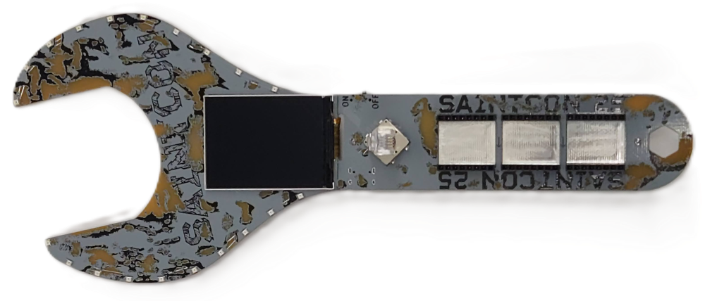

# SAINTCON 2025 Wrench Badge - Wireless Foxhunter Suite 🦊📡

[](LICENSE)
[](https://www.espressif.com/en/products/socs/esp32-s3)
[](https://platformio.org/)



Directional RF signal tracking and "foxhunting" instrument firmware engineered for the **SaintCon 2025 Wrench Badge** (ESP32-S3). Tracks 2.4GHz Wi-Fi APs and Bluetooth LE transmitters with a real-time signal HUD and dual-jaw NeoPixel signal meter.

> ⚠️ **Work in Progress**: This project is actively under development. If you run into any issues, bugs, or have suggestions, please [open an issue](https://github.com/BrainVirus/SAINTCON2025-FoxHuntBadge/issues) or reach out!

---

## ⚡ Features

- **Wi-Fi 2.4GHz & BLE Tracking**: Single-protocol radio scanning to eliminate RF noise floor interference and antenna contention.
- **Dual-Jaw LED Meter**: 10 vertical signal levels across 20 WS2812B LEDs with analog floating peak hold and contact burst.
- **Real-Time Display HUD**: Bold RSSI readout, proximity status, 60-sample rolling waveform graph, packet arrival rate, and on-screen wrench mirror.
- **8 Color Themes & Dimming**: Selectable LED color palettes and brightness slider with NVS flash persistence.
- **USB Serial CLI**: Remote control, scanning, and metrics streaming over USB at 115200 baud.

---

## 🎮 Controls

| Screen | Input | Action |
|---|---|---|
| **Main Menu** | **Up / Down** | Select `[WI-FI]`, `[BLE]`, or `[OPTS]` |
| | **Center Click** | Open selection |
| **Target List** | **Up / Down** | Scroll discovered targets (sorted by RSSI) |
| | **Center Click** | Select target and start tracking HUD |
| | **Left** | Trigger new target scan |
| | **Center Hold** | Return to Main Menu |
| **Foxhunt HUD** | **Center Click** | Pause / Resume tracking |
| | **Left / Center Hold** | Stop tracking & return to target list |
| | **Right** | Reset peak RSSI & waveform history |
| | **Up / Down** | Adjust sensitivity threshold floor ($\pm 3$ dBm) |
| **LED Options** | **Up / Down** | Select Theme, Brightness, or Back |
| | **Left / Right** | Cycle 8 color palettes / adjust brightness |
| | **Center Hold** | Save to flash and return to Main Menu |

---

## 💻 Serial CLI (115200 baud)

```text
scan               - Trigger new target scan
list               - Print discovered targets
track <index|mac>  - Track target by index or MAC address
stop               - Stop tracking and return to list
proto <wifi|ble>   - Switch wireless protocol
themes             - List available LED color themes
theme <0-7|name>   - Set LED color palette theme
bright <0-255>     - Adjust LED meter brightness
status             - Show current tracking status & metrics
```

---

## 🚀 Building & Flashing Guide

Everything is automated through PlatformIO—compilers, ESP32-S3 toolchains, and required libraries install automatically on your first build.

### Option A: VS Code (Recommended / Easiest)

1. **Install Prerequisites**:
   - Download and install [Visual Studio Code](https://code.visualstudio.com/).
   - Open VS Code, open the Extensions view (`Ctrl+Shift+X` or `Cmd+Shift+X`), search for **PlatformIO IDE**, and click **Install**.
2. **Open the Project**:
   - Clone or download this repository.
   - In VS Code, go to **File > Open Folder...** and select the `SAINTCON2025-FoxHuntBadge` folder.
3. **Connect Your Badge**:
   - Connect the badge to your computer using a **USB-C data cable** (make sure it supports data, not just charging).
4. **One-Click Build & Flash**:
   - In the bottom blue status bar of VS Code, click the **`→` (PlatformIO: Upload)** button. PlatformIO will download dependencies, compile the code, and flash the badge automatically.
5. **View Live Serial Logs & CLI**:
   - Click the **`🔌` (PlatformIO: Serial Monitor)** icon on the bottom status bar (connects at 115200 baud).

---

### Option B: Terminal / CLI

1. **Install PlatformIO Core**:
   ```bash
   pip install platformio
   ```
2. **Clone & Enter Repo**:
   ```bash
   git clone https://github.com/BrainVirus/SAINTCON2025-FoxHuntBadge.git
   cd SAINTCON2025-FoxHuntBadge
   ```
3. **Flash to Badge**:
   ```bash
   pio run -t upload
   ```
4. **Open Serial Monitor**:
   ```bash
   pio device monitor -b 115200
   ```

---

## 🤖 AI Disclaimer

This project was developed with the assistance of artificial intelligence tools for code scaffolding, architecture design, and documentation. While the code has been structured to hardware specifications and verified to build cleanly, please report any edge cases or unexpected behavior.

---

## 📜 License

This project is licensed under the [MIT License](LICENSE).
